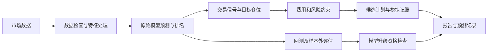

# AshareQuant

面向 A 股的本地量化研究、预测、风险管理与模拟交易系统。持续观察 20–50 只股票，以主板为主，把行情、模型判断、交易成本和仓位约束整理成可追溯的分析报告。

它不是“保证赚钱”的选股工具。与普通行情软件相比，本项目重点是记录每次预测、验证预测是否有效、比较策略并持续模拟记账。使用者可以查看判断依据和不交易原因，开发者可以复现计算和测试。

## 能做什么

| 能力 | 代码状态与边界 |
|---|---|
| 历史数据、行情更新与完整性检查 | 已实现；接口可用性和数据时效需逐次检查 |
| 收益预测及 1/5/20 交易日期限分析 | 已实现；缺数据或验证不足会明确标记 |
| 七项指标及九因素评分 | 已实现；预测收益、上涨概率、波动率、下行风险、区间、不确定性、评分；研究概率不等于已校准概率 |
| 四类组合方法 | 等权、风险平价、均值方差、约束评分；是否可正式启用仍由验证决定 |
| 费用、现金、T+1、交易单位及状态检查 | 已实现；目标仓位与可执行候选计划分开 |
| 历史回测、样本外验证与模型迭代 | 已实现；候选失败时保留原模型，不保证每日升级 |
| 连续模拟账户与收益统计 | 已实现；多个独立账本用于策略对照，不动真实资金 |
| 盘中走势、新闻/公告辅助研究 | 已实现研究路径；使用行情与有时间标记的事件，新闻主要为标题/摘要规则，不等于完整公告语义分析 |
| 每日总览与详细报告 | 已实现；保留对照报告、研究计划、验证结果和收益记录 |
| 定时任务 | 有本地调度入口；安装代码不会自动注册服务，运行电脑须保持可用 |
| 券商持仓 | 支持导出记录/账户快照导入；不代表实时券商连接 |
| 真实自动下单 | **未实现、未启用**；当前程序没有真实券商下单通道 |

开发中/待完善：跨机器部署验收、数据接口稳定性、模型长期前瞻验证、模块化迁移。实时券商接入和实盘执行属于后续独立工作，不能把模拟成交当成券商成交。

## 工作原理



原始预测与决策层分开：改变仓位预算不应改变模型预测值。盘中动态研究与旧策略使用独立模拟账本做对照；正式模型资格不因模拟收益好就自动获得。

## 项目目录

```text
asharequant/
  data_sources/       数据库及券商导出记录处理
  models/             原模型函数的公共入口
  strategies/         下一交易日计划
  risk/               独立风险控制计划
  backtesting/        历史研究与回测
  evaluation/         预测质量、验证准备和数据连接检查
  reporting/          总览、详细报告和持仓摘要
  forecast.py         保留路径的特征与收益预测核心
  decision.py         组合分配和交易约束
  lifecycle.py        Champion–Challenger 验证与迭代
  intraday.py         盘中对照模拟
  adaptive_intraday.py 盘中动态研究模拟
  cli.py              命令入口
  daily.py            每日流水线
  scheduler.py        北京时间调度
config/               非敏感配置模板
scripts/              初始化等维护入口
tests/                自动化测试
docs/                 架构与安全说明
tools/                原有数据源维护工具
requirements*.txt     基础依赖和研究环境版本记录
```

部分核心实现保留原路径，因为模型和模拟账本用源码指纹核验版本。旧导入入口保留兼容；不应仅凭文件名相似就删除。完整对应关系见 [代码导航](docs/ARCHITECTURE.md)。

## 快速开始

建议 macOS/Linux、Python 3.11。文件锁使用 `fcntl`，原生 Windows 尚未支持。以下测试使用既有 Python 环境验证；全新机器的完整依赖安装及所有网络接口不能据此宣称已验收。

```bash
git clone --branch maintenance/project-organization https://github.com/zhengbowei0096-bot/AshareQuant-Private.git
cd AshareQuant-Private
python3.11 -m venv .venv
source .venv/bin/activate
python -m pip install -r requirements.txt
python scripts/init_config.py
python -m asharequant.cli --help
python -m unittest discover -s tests
```

初始化只生成缺少的本地文件，不覆盖已有配置。`watchlist.csv` 示例股票默认禁用；请准备自己的有效观察池并核实上市日期、交易状态与数据覆盖。账户、费率和凭据放本地，不能提交 Git。模板不包含任何真实持仓或真实账户。

运行入口（在项目目录执行）：

```bash
# 检查已有数据，不等于自动补齐
python -m asharequant.cli check --root .
# 获取数据并执行既有研究流程，需要网络和有效观察池
python -m asharequant.cli run --root .
# 运行每日流程：受北京时间及交易日限制
python -m asharequant.cli daily --root .
# 检查最近完整交易日流程，会产生本地记录
python -m asharequant.cli daily-verify --root .
```

更多入口使用 `--help` 查看，包括 `forecast`、`decision`、`portfolio-validate`、`lifecycle`、`paper-account`、`active-research`、`connection-health`。训练研究依赖可参考 `requirements-models.lock.txt` 和 `requirements-risk-models.lock.txt`；这些是已有环境版本记录，不保证任意平台均可安装。

## 每日与盘中工作

每日流程包括历史刷新、分析、模拟账户处理、模型生命周期检查、严格验证、组合验证、执行重放、模型监测、预测质量审计及连接检查。北京时间 18:00 后按交易日执行；失败阶段会留下记录。定时服务属于本地部署配置，不随公开源码打包。

盘中服务按既有配置刷新行情（当前支持 30 秒轮询）；动态研究使用短时价格走势、相对表现、波动和事件信息修正模拟决策。事件有发布时间和首次观察时间，陈旧或无法确认的信息会限制行动。30 秒轮询不等于交易所实时专线。

电脑关机、休眠、断网或登录服务未启动时不能保证执行。每日报告包含流程状态；“生成报告”不代表所有数据与模型均通过验证。

## 如何阅读结果

- **预测收益率**：指定未来交易日期限的估计，不能当成确定收益。
- **上涨概率**：区分研究估计与独立校准通过状态；未知不填造假的 50%。
- **波动率、下行风险、区间与不确定性**：表示可能变化范围与模型可信程度，不是止损保证。
- **评分和排名**：观察池内相对比较；最高分不代表一定值得买。
- **目标仓位**：研究配置目标，不是当前仓位最优的证明。
- **BUY/ADD/HOLD/REDUCE/SELL/WAIT/NO_TRADE**：依报告路径显示买入、加仓、持有、减仓、卖出、观望或不可执行；必须同时读原因、股数与执行条件。
- **模拟收益**：按该账本的成交假设、费用和估值计算；没有发生真实资金交易。不同模拟账本不可混算。
- **回测指标**：年化收益、夏普、最大回撤、波动、换手、成本等需结合样本外结果，不可只看收益。

报告主要位于本地 `reports/`，状态/预测/账本位于 `data/`；桌面导出位置由本地报告配置决定。网页可能包含私人持仓，不能作为公开演示直接上传。

## 数据与验证边界

代码包含 AkShare、腾讯、新浪、BaoStock 等数据路径及可选数据源配置。各接口用于不同历史、行情或交叉检查任务，不保证每个来源随时可用。新闻/公告辅助研究不保证全量覆盖或即时发布。行情价格应连同来源和时间一起解释。

回测与候选模型验证采用时间序列划分、成本评估和风险检查；实现这些机制不代表某模型已经通过。前瞻验证必须等真实预测到期，不能用回填记录假装积累。正式升级失败就保留旧模型。

## 常见问题

- 缺少 `config.json`：先运行初始化脚本；不要复制他人的私人账户配置。
- 没有可分析股票：示例观察池禁用，请配置自己的股票并检查数据完整性。
- 报告不交易：查看净预期收益、费用、流动性、资金、状态、模型资格等限制原因，不能为了交易取消校验。
- 接口或 TLS 失败：检查网络、上游变化和本地证书，不关闭证书验证。
- 没有自动运行：检查本地调度服务、北京时间、交易日和电脑是否休眠；源码存在不代表服务已安装。
- 导入失败：从仓库根目录运行，确认使用安装了依赖的同一个 Python 环境。

## 风险、维护与许可证

数据可能错误或延迟，模型可能过拟合，费用和滑点可能吞掉小额交易优势，极端行情可能无法成交。项目旨在提供可审计的研究，不承诺收益，也不承诺每天模型变好。

本次整理保留原算法、风险参数与交易规则。新增分组通过兼容入口连接；有疑问的历史文件保留，缓存删除前备份。后续重点是部署可重复性、长期前瞻评估和版本指纹迁移，避免用重构使历史记录失效。

仓库当前未指定开源许可证；公开可见不等于授予任意再分发许可。详情见 [安全与发布说明](docs/SECURITY.md)。

整理验收和恢复说明见 [验证记录](docs/VALIDATION.md)。
